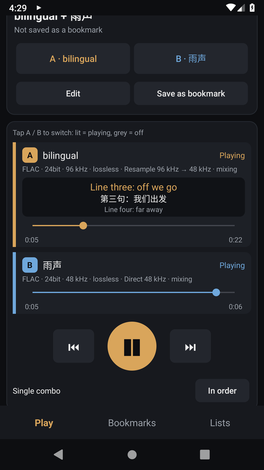
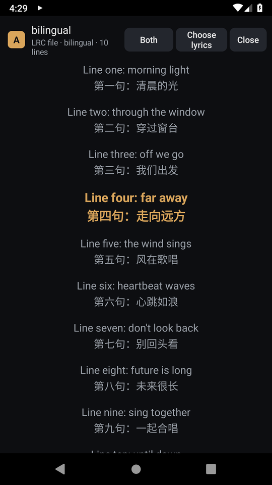
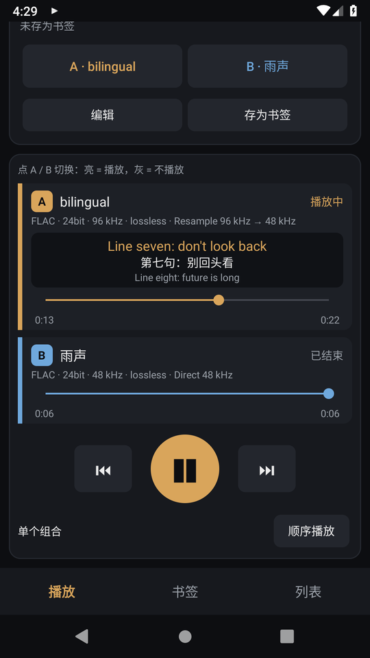

<p align="center">
  
</p>

<h1 align="center">DuoPlayer Hi-Fi</h1>

<p align="center">
  <b>Play two lossless audio files at the same time — built for Sony Android Walkman.</b><br>
  Music + rain, song + metronome, audiobook + white noise… A and B start with one button and mix inside a 64-bit engine.
</p>

<p align="center">
  <a href="https://github.com/AIcivilization/duoplayer/releases/latest"></a>
  <a href="https://github.com/AIcivilization/duoplayer/releases"></a>
  
  
  
  
  
  <a href="LICENSE"></a>
</p>

<p align="center">
  <b>English</b> · <a href="README.zh-CN.md">简体中文</a> · <a href="README.ja.md">日本語</a>
</p>

<p align="center">
  
  
  
</p>

## Features

- **Two tracks, one Play button.** A and B are set up in one card (tap the A / B tab to edit each), then a single ▶ starts both.
- **Light = playing, grey = off.** Tap a track's bar during playback to mute or un-mute it.
- **Bookmarks.** Save an A + B combo with all its settings (files, lyrics, volume, balance, loop, on/off) under any name. Next time, one tap plays it.
- **Continuous playback.** Two kinds of list:
  - a bookmark list (each combo plays, then the next starts);
  - a file list (files go through A one by one, while B keeps playing your background sound).
  - Play in order, repeat the list, or repeat one item.
- **Bilingual lyrics.**
  - Lyrics come from a `.lrc` file or are read from the audio file itself (FLAC, MP3, DSF, WAV/AIFF).
  - GBK, UTF-8 and UTF-16 encodings are detected automatically.
  - Original + translation lines are shown together; tap a line to seek; switch between Both / CJK / Latin.
- **Lossless engine.**
  - Decoding: FLAC, WAV, AIFF and DSD (DSF) are decoded natively, not by Android's MediaCodec.
  - Mixing: a 64-bit float bus combines A and B.
  - Resampling: −130 dB stopband; skipped when the source rate already matches the output, so the path stays **bit-perfect**.
- **Backup & restore** to a JSON file, plus **Relink folder**, which finds your files again after a reinstall or on a new device.
- **In-app updates** from GitHub Releases, with a signature check before installing.
- **17 languages**, chosen automatically from the system language.

## Supported devices

| Device | Android | Status |
|---|---|---|
| **NW-ZX505 / ZX507** (ZX500 series) | 9 | Primary target |
| **NW-A105 / A106 / A107** (A100 series) | 9 | Should work: same platform as ZX500 |
| **NW-WM1AM2 / WM1ZM2** | 11 | Should work |
| **NW-A306 / A307** (A300 series) | 12 | Should work |
| **NW-ZX706 / ZX707** (ZX700 series) | 12 | Should work |
| Any Android 9+ phone or DAP | 9+ | Works (generic AAudio path) |
| NW-ZX1 / ZX2 / F880 / Z1000 | ≤ 4.4 | Not supported (needs Android 9) |

> So far the app has been tested in an Android 9 emulator only. Please share your Walkman's results by opening a [device report](https://github.com/AIcivilization/duoplayer/issues/new?template=device-report.md): model, firmware, and the sample rate shown at the top of the app.

## Install

1. Download `duoplayer-x.y.apk` from **[Releases](https://github.com/AIcivilization/duoplayer/releases/latest)**.
2. Copy it to the Walkman and open it with the file manager, or run `adb install -r duoplayer-x.y.apk`.
3. Later versions update from inside the app (Lists page → **Check update**).

## Best sound on a Walkman

- **Turn on High-Res streaming:** Settings → Sound → **High-Res streaming**.
  - On the A100 and ZX500 series, Sony's firmware limits third-party apps to 48 kHz / 16-bit when this is off, and gives them 192 kHz / 32-bit when it is on.
  - The status line at the top of the app shows the rate it actually gets.
- **Leave A / B volume at 0 dB** and use the hardware volume buttons. The S-Master HX amplifier then sets the level.
- The green **bit-perfect** tag means the samples reach the system exactly as they are in the file. This happens when:
  - only one track is playing;
  - volume is at 0 dB and balance is centered;
  - the file's sample rate equals the output rate;
  - the file is 24-bit or lower.
- **Both 3.5 mm and 4.4 mm balanced outputs work.** Unplugging headphones pauses playback.
- **Hardware keys:** play/pause controls both tracks; previous/next move through the list.

## Audio engine

```
file A ─► decoder ─► resampler (to native rate) ─► 2 s ring buffer ─┐
                                                                     ├─► 64-bit mix ─► peak guard ─► float32 ─► AAudio
file B ─► decoder ─► resampler (to native rate) ─► 2 s ring buffer ─┘
```

| Stage | Implementation |
|---|---|
| FLAC / WAV / AIFF / RF64 | dr_flac / dr_wav, 32-bit integer output (Android 9's own FLAC decoder truncates to 16-bit) |
| DSD (.dsf, DSD64–256) | Kaiser FIR decimation via byte lookup tables → 176.4 kHz PCM |
| MP3 / AAC / ALAC / OGG / Opus | System NDK MediaCodec |
| Resampler | Rational polyphase Kaiser; 44.1 k → 192 k THD+N −154 dB; bypassed when rates match |
| Mix | 64-bit float sum; the peak guard only acts above full scale |
| Output | AAudio, float32, at the device's native rate |

The numbers above come from `hosttest/run.sh`, which compiles the same C++ engine on a computer and measures it.

## Languages

English, 简体中文, 繁體中文, 日本語, 한국어, Français, Deutsch, Español, Italiano, Português, Русский, Polski, Nederlands, Türkçe, Tiếng Việt, ไทย, Bahasa Indonesia.

Translations live in [`i18n/*.txt`](i18n) (one `key = text` per line). To add or fix a language, edit the file and run `python3 i18n/build_strings.py`. The script checks that every placeholder matches the English file. Pull requests are welcome.

## Build

You need JDK 17, Android SDK 34, NDK 26.3.11579264 and CMake 3.22.1.

```bash
./gradlew assembleRelease
```

Maintainers publish a release with `scripts/release.sh`. The release signing key is stored outside the repository.

## License

[MIT](LICENSE). Bundled [dr_flac / dr_wav](https://github.com/mackron/dr_libs) are Public Domain / MIT-0.

*Sony, Walkman and S-Master are trademarks of Sony Group Corporation. This is an independent project and is not affiliated with Sony.*
