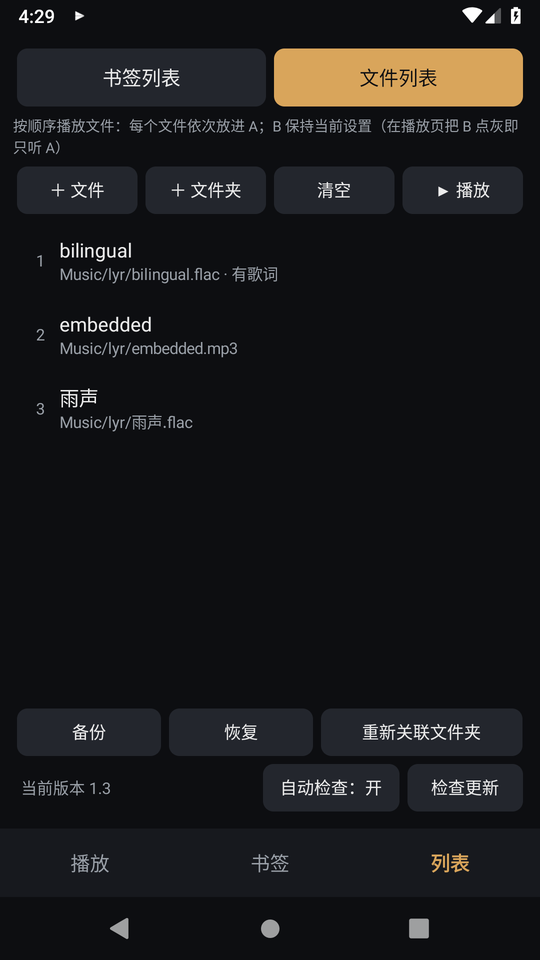

<p align="center">
  
</p>

<h1 align="center">双轨 Hi-Fi（DuoPlayer）</h1>

<p align="center">
  <b>两个无损音频同时在耳机里播放：专为索尼安卓 Walkman 设计。</b><br>
  音乐 + 雨声、歌曲 + 节拍器、有声书 + 白噪音……A、B 一键同时开播，在 64bit 引擎里混音。
</p>

<p align="center">
  <a href="https://github.com/AIcivilization/duoplayer/releases/latest"></a>
  <a href="https://github.com/AIcivilization/duoplayer/releases"></a>
  
  
  
  
  
  <a href="LICENSE"></a>
</p>

<p align="center">
  <a href="README.md">English</a> · <b>简体中文</b> · <a href="README.ja.md">日本語</a>
</p>

<p align="center">
  
  
  
</p>

## 功能

- **A、B 组合卡片**：点 A 标签就设置 A，点 B 标签就设置 B；点「保存」后卡片标题显示「A名 + B名」。
- **只有一个播放键**：按一下，A 和 B 同时开始播放。
- **亮 = 播放，灰 = 不播放**：播放中点一下某一路就停掉它，再点一下恢复。只想听其中一路时很方便。
- **书签**：把当前 A+B 组合存成书签，名称可以自己起。保存的内容包括两路的文件、歌词、音量、声像、循环和开关状态，以后点一下书签就能直接播放。
- **连续播放**，有两种列表：
  - 书签列表：每个组合放完，自动播下一个；
  - 文件列表：文件依次放进 A 播放，B 一直保持当前设置，比如一直放雨声。
  - 播放模式：顺序 / 列表循环 / 单项循环。
- **中英双语歌词**：
  - 来源：同名 `.lrc` 文件，或文件内嵌的歌词（FLAC、MP3、DSF、WAV/AIFF）；
  - 编码：自动识别 GBK、UTF-8、UTF-16；
  - 显示：原文和译文一起显示，点某一句可跳转，可切换「双语 / 中文 / English」。
- **无损引擎**：
  - FLAC/WAV/AIFF/DSD 由应用自己解码，不经过安卓的 MediaCodec；
  - 两路在 64bit 浮点精度下混音；
  - 重采样器阻带衰减 -130 dB，源和输出采样率相同时直接跳过，保持**位精确**。
- **备份与恢复**：导出成 JSON 文件；重装应用或换设备后，用「重新关联文件夹」自动找回文件。
- **应用内自动更新**：从 GitHub Releases 下载新版，安装前校验签名。
- **17 种界面语言**，自动跟随系统语言。

## 支持的设备

| 型号 | 安卓 | 状态 |
|---|---|---|
| **NW-ZX505 / ZX507**（ZX500 系列） | 9 | 主要适配对象 |
| **NW-A105 / A106 / A107**（A100 系列） | 9 | 应可用，平台与 ZX500 相同 |
| **NW-WM1AM2 / WM1ZM2** | 11 | 应可用 |
| **NW-A306 / A307**（A300 系列） | 12 | 应可用 |
| **NW-ZX706 / ZX707**（ZX700 系列） | 12 | 应可用 |
| 其他 Android 9+ 手机或播放器 | 9+ | 可用（通用 AAudio 输出） |
| NW-ZX1 / ZX2 / F880 / Z1000 | ≤ 4.4 | 不支持（需要 Android 9） |

> 目前只在 Android 9 模拟器上做过测试。欢迎用 [设备反馈](https://github.com/AIcivilization/duoplayer/issues/new?template=device-report.md) 告诉我们你的型号、固件版本，以及应用顶部显示的输出采样率。

## 安装

1. 到 **[Releases](https://github.com/AIcivilization/duoplayer/releases/latest)** 下载 `duoplayer-x.y.apk`。
2. 拷进 Walkman，用文件管理器打开安装；也可以用 `adb install -r duoplayer-x.y.apk`。
3. 以后的版本可以在应用里更新：「列表」页 →「检查更新」。

> 从 1.2 及更早版本升级时，需要手动重装一次，因为旧版用的是临时签名：
> 1. 在旧版「列表」页点「备份」；
> 2. 卸载旧版，安装新版；
> 3. 点「恢复」，再点「重新关联文件夹」。

## 在 Walkman 上获得最好的音质

- **打开 High-Res streaming（高解析度流媒体）**：设置 → 声音 → **High-Res streaming**。
  - A100 / ZX500 系列关闭这个开关时，第三方应用会被降到 48kHz/16bit；打开后是 192kHz/32bit。
  - 应用顶部会显示实际拿到的输出采样率。
- **A / B 的音量保持 0 dB**，用机身音量键调总音量，交给 S-Master HX 数字功放处理。
- 路径行显示绿色「**位精确**」时，送进系统的样本与文件完全一致。需要同时满足：
  - 只有一路在播；
  - 音量 0 dB，声像居中；
  - 文件采样率等于输出采样率；
  - 位深不超过 24bit。
- **3.5mm 和 4.4mm 平衡口都能用**，拔掉耳机会自动暂停。
- **侧面实体键**：播放 / 暂停同时控制两路；上一首 / 下一首切换列表里的项目。

## 音频链路

```
文件 A ─► 解码 ─► 重采样到系统原生采样率 ─► 2 秒缓冲 ─┐
                                                    ├─► 64bit 混音 ─► 峰值保护 ─► float32 ─► AAudio
文件 B ─► 解码 ─► 重采样到系统原生采样率 ─► 2 秒缓冲 ─┘
```

| 环节 | 做法 |
|---|---|
| FLAC / WAV / AIFF / RF64 | dr_flac / dr_wav 输出 32bit 整数（Android 9 自带的 FLAC 解码器会把 24bit 截成 16bit） |
| DSD（.dsf，DSD64–256） | Kaiser FIR 抽取 + 字节查表 → 176.4kHz PCM |
| MP3 / AAC / ALAC / OGG / Opus | 系统 NDK MediaCodec |
| 重采样 | 有理数多相 Kaiser；44.1k→192k 的 THD+N 为 -154 dB；采样率相同时跳过 |
| 混音 | 64bit 浮点相加；只有超过满幅时峰值保护才起作用 |
| 输出 | AAudio，float32，系统原生采样率 |

上面的指标来自 `hosttest/run.sh`：它在电脑上编译同一份 C++ 引擎，再做数值测试。

## 使用说明

### 播放页
- 组合卡片里点 A / B 标签，可以设置每一路的音频、歌词、音量、声像、单曲循环和开关。
- 「组合什么时候算放完」：所有开启、并且没开单曲循环的那几路都放完，才算结束。所以「音乐 + 循环雨声」会在音乐结束时一起停，或者跳到下一项。

### 书签
- 点一下：载入并播放。
- 长按：只载入 / 加入书签列表 / 重命名 / 用当前组合覆盖 / 上移下移 / 删除。

### 列表
- 点列表里的一项，就从那里开始播放。
- 长按可以上移、下移、移出列表；文件列表里还能「放入 A / 放入 B」。
- 建议用「＋文件夹」导入：安卓 9 对单个文件的永久授权有数量上限，按文件夹授权没有这个问题。

### 歌词
- 用「＋文件夹」导入时，同目录下同名的 `.lrc` 会自动关联；用「＋文件」时，把 `.lrc` 和歌曲一起选中即可。
- 双语 LRC 支持两种写法：
  - 同一时间戳写两行（网易云、QQ 音乐导出的就是这种格式）；
  - 同一行用 ` / ` 分隔。
- 也支持 `[offset:]` 时间偏移、一行多个时间戳、逐字时间戳。

### 备份与恢复
- 「备份」把书签、两个列表、当前组合和播放模式导出成 `.json` 文件。
- 「恢复」可以选「替换」或「合并」。
- 「重新关联文件夹」按原路径和文件名找回文件；同名文件选末尾路径最接近的那个，匹配不确定时不会乱关联。

### 自动更新
- 每天最多检查一次 GitHub 上的最新版本。
- 第一次更新时，需要允许本应用「安装未知应用」。
- 国内网络访问 GitHub 可能不稳定，检查失败不影响播放；也可以点版本号打开发布页手动下载。

## 界面语言

English、简体中文、繁體中文、日本語、한국어、Français、Deutsch、Español、Italiano、Português、Русский、Polski、Nederlands、Türkçe、Tiếng Việt、ไทย、Bahasa Indonesia。

翻译文件在 [`i18n/*.txt`](i18n)，每行一条 `key = 文字`。修改后运行 `python3 i18n/build_strings.py`，脚本会生成各语言资源，并检查每条翻译的占位符（%1$s 等）是否和英文一致。欢迎提交 PR 改进翻译。

## 构建与发布

需要 JDK 17、Android SDK 34、NDK 26.3.11579264、CMake 3.22.1。

```bash
./gradlew assembleRelease
```

发布新版本的步骤：
1. 修改 `app/build.gradle.kts` 的 `versionCode`（加 1）和 `versionName`；
2. 写 `release-notes/v<版本>.md`；
3. 提交代码后运行 `scripts/release.sh`。

发布签名密钥保存在维护者本机的 `~/.config/duoplayer/`，不在仓库里。

## 许可证

[MIT](LICENSE)。内置的 [dr_flac / dr_wav](https://github.com/mackron/dr_libs) 采用 Public Domain / MIT-0 双许可。

*Sony、Walkman、S-Master 是索尼集团的商标。本项目为独立开发，与索尼无关。*
